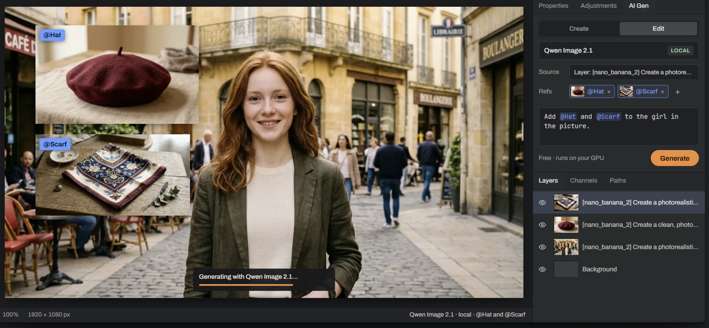
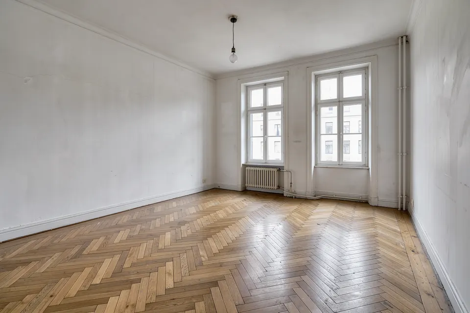
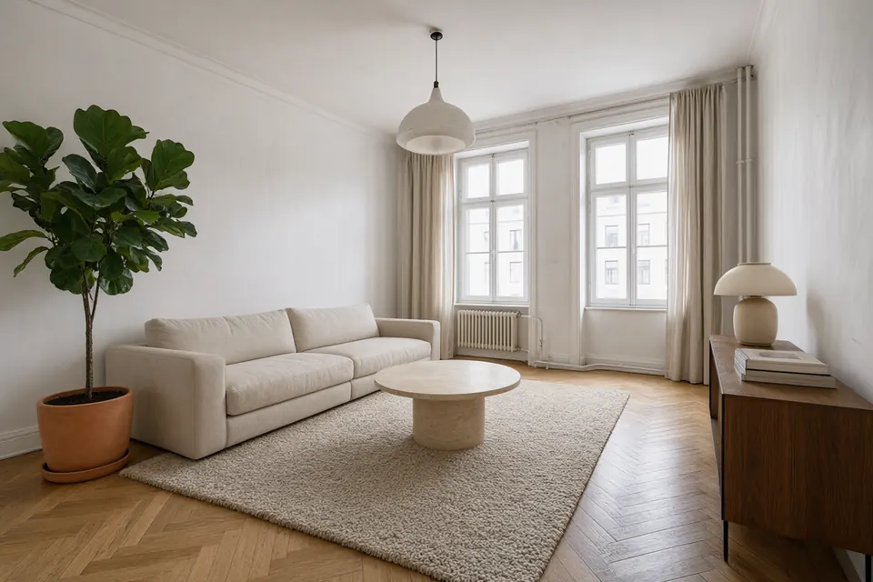
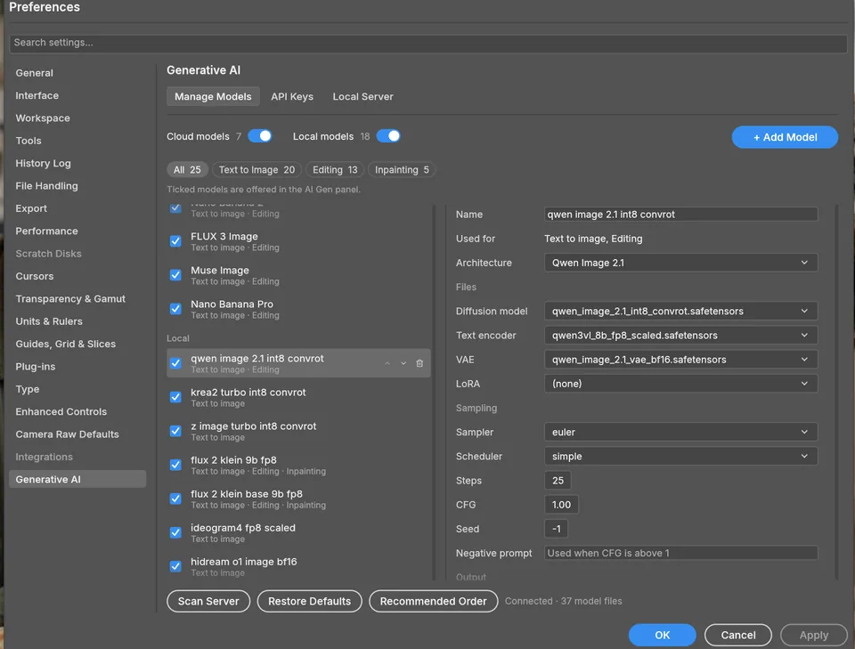

<h1 align="center">LayerShop</h1>

<p align="center">
  <b>A free, open-source image editor laid out like Photoshop, with generative AI built in.</b><br>
  Select an area, describe the change, and the result lands on its own masked layer.<br>
  Local models run on your own graphics card. Nothing leaves your PC.
</p>


<p align="center">
  <a href="https://layershop.aardvarkstudios.net/download/"><b>Download for Windows</b></a> ·
  <a href="https://layershop.aardvarkstudios.net/">Website</a> ·
  <a href="https://github.com/SlavomirDurej/layershop/releases">Releases</a> ·
  <a href="https://github.com/SlavomirDurej/layershop/issues">Report a bug</a>
</p>

<p align="center">
  
  
  
  
</p>

<p align="center">
  
</p>

https://github.com/user-attachments/assets/476dd370-8cc9-4476-8401-1771848b3de3

▶ [Watch the 3½-minute walkthrough on YouTube](https://youtu.be/dCBiipZ03dA)

> [!NOTE]
> **Preview.** LayerShop is early software: the AI integration is new and has been tested on only a few PCs. It runs on **Windows 10 and 11 (x64)** only. Please [report what breaks](https://github.com/SlavomirDurej/layershop/issues).

## What it is

LayerShop is a native image editor (layers, masks, adjustment layers, layer styles, type, vector shapes, real PSD files) with one new panel, **AI Gen**:

- **Create** makes a new picture from a prompt and puts it on a new layer.
- **Regions** lay a new picture out before it is made: draw boxes on the canvas and say what goes in each (an object, a character, or exact words to render), then describe the whole scene. Models trained on boxes place things where you drew them: MOSS Image, Ideogram 4, FLUX.3 Klein and FLUX 3; FIBO 2 follows them roughly. The layer keeps its layout, so **Load from layer** brings the boxes, the scene and the model back to try again.
- **Edit** changes only the part you select. A lasso, Select Sky or a painted mask says where; Canvas Size makes room; an alpha channel gives you a cutout. Outside the selection, not a pixel moves.
- **References.** Turn a layer from this or any open document into a named reference (`@Hat`, `@Scarf`) and use it in the prompt. References are saved with the document.
- **Restyle** repaints a layer in another style at a strength you choose.

Every result arrives as a new, named, masked layer above the last, so you can hide it, mask it, blend it or throw it away.

<table>
  <tr>
    <td width="50%"><br><sub><b>Before:</b> an empty room.</sub></td>
    <td width="50%"><br><sub><b>After:</b> one Edit prompt, Qwen Image 2.1 on a local GPU. The floor, walls, windows and light are unchanged.</sub></td>
  </tr>
</table>

## How the AI works

LayerShop does not ship its own model. It drives [ComfyUI](https://github.com/comfyanonymous/ComfyUI) behind the scenes: it builds the graph, picks the model files and the sampler settings, and returns the picture as a layer. You never have to open ComfyUI.

- **Setup wizard.** The first time you open AI Gen, a five-step wizard checks your PC and sets up local AI: it installs a private ComfyUI with its own Python and downloads the models you pick. It uses built-in ComfyUI nodes only, so there are no custom nodes to maintain.
- **Already run ComfyUI?** Point LayerShop at your server and your models. A server it did not start is never stopped.
- **Local models** (run on your GPU, work offline once installed): Qwen Image 2.1 (the default for editing), FLUX.3 Klein, FLUX.2 Klein 9B, Z-Image Turbo, MOSS Image (small, suited to weaker cards), Krea 2 Turbo, Ideogram 4, FIBO 2 Dev (creates and edits), HiDream O1, Ernie Image Turbo and Ming Image 0.1 Design.
- **Cloud models** (optional, with your own API key, billed by the provider): OpenAI GPT Image, Google Nano Banana, Black Forest Labs FLUX 3, xAI Grok Imagine and Meta Muse Image.
- **Model manager.** Preferences › Generative AI scans your server, takes your own model files, tunes the sampler, and takes custom ComfyUI workflows in API format.

<p align="center">
  
</p>

### Requirements and costs

| | |
|---|---|
| System | Windows 10 or 11, 64-bit. macOS and Linux installers are not built yet. |
| Graphics card | An NVIDIA card for local models. Tested on an RTX 4090 (24 GB); on cards under 16 GB the wizard starts with the small MOSS Image model. Without a usable card you can still use cloud models. |
| Disk | About 25 GB to start: up to 6 GB for the engine and 11 to 46 GB per model. An SSD loads models much faster. |
| Cost | The app is free. Local models cost nothing per image. Cloud models cost whatever the provider charges. |

**Model licences differ.** Some models are licensed for non-commercial use only, and some (FLUX.3 Klein) are gated behind a Hugging Face sign-in and licence acceptance. The wizard lists each model's licence and whether it allows commercial work; check it before using a model's images commercially.

## Download

Get the latest build from the **[download page](https://layershop.aardvarkstudios.net/download/)** or the [Releases](https://github.com/SlavomirDurej/layershop/releases) page:

| File | What it is |
|---|---|
| `layershop-<version>-windows-x64.msi` | Installer (Start Menu shortcut, file associations). Installs the editor only; local AI is set up by the wizard on first start. |
| `layershop-<version>-windows-x64-portable.zip` | Unzip anywhere and run `photocraft.exe`. Settings stay in a `LayerShopData` folder beside it. |
| `SHA256SUMS.txt` | Checksums for both files. |

**The files are not code-signed yet**, so Windows SmartScreen may show "Windows protected your PC". Choose **More info › Run anyway**, and compare the file's SHA-256 with `SHA256SUMS.txt` if you want to check it.

## The editor underneath

LayerShop's editor is [PhotoCraft](https://github.com/storytold/photocraft), an open-source, clean-room Photoshop-style editor written entirely in Rust (native egui on wgpu, no Electron or web view). That means:

- Menus, shortcuts and panels where Photoshop users expect them.
- Layers, groups, clipping and layer masks, adjustment layers, layer styles, smart objects, type and vector shapes.
- Real PSD and PSB files, 8/16/32-bit colour, RGB, CMYK, Gray and Lab, with ICC colour management.
- A brush engine, selections and 67 tools, and every action available as a command from the UI, a CLI, a JSON control channel or an MCP server.

PhotoCraft's own status is early alpha: it is **not yet a Photoshop replacement for daily professional work**. Its [roadmap](ROADMAP.md) and [parity assessment](docs/target-app-parity.md) give the honest, dimension-by-dimension picture. For the full editor feature tour with screenshots, see the [PhotoCraft README](https://github.com/storytold/photocraft#readme).

## How this relates to PhotoCraft

LayerShop is a fork of PhotoCraft by the [ArtCraft](https://getartcraft.com/) team and its contributors, used under its MIT / Apache-2.0 licence (this preview includes PhotoCraft 0.17.0). What LayerShop adds:

- the AI Gen panel (Create, Regions, Edit, Restyle and references),
- the local setup wizard and ComfyUI management,
- the model manager and the supported-model workflows,
- the Windows installer and the website.

The ArtCraft name and logos are their trademarks and are not part of this project. LayerShop is independent and is not affiliated with, sponsored by or endorsed by the ArtCraft team, Comfy Org or Adobe Inc.

## Build from source

You need a recent stable Rust toolchain.

```sh
git clone https://github.com/SlavomirDurej/layershop
cd layershop
cargo run --release -p photocraft -- image.psd   # the desktop app (binary and crates keep the photocraft name)
cargo test -p photocraft-ui-egui --lib --tests   # one crate's tests; see docs/development.md for the rest
```

Start with [`AGENTS.md`](AGENTS.md) and [`docs/`](docs/) for the architecture, the command registry and the rules for contributing. The AI side is documented in [`docs/ai-generation.md`](docs/ai-generation.md). Test corpora, the control protocol and the release process are in the PhotoCraft docs.

## Support and feedback

- **Bugs:** [open an issue](https://github.com/SlavomirDurej/layershop/issues/new/choose). The template asks for your Windows version, GPU, and which setup step you reached, which is what makes a setup problem fixable.
- **Questions and ideas:** [Discussions](https://github.com/SlavomirDurej/layershop/discussions).
- **Security:** see [SECURITY.md](SECURITY.md).
- **Keeping it free:** LayerShop is made in one person's spare time; the [website](https://layershop.aardvarkstudios.net/) has a donate link. Paid custom development is also available there.

## License and credits

LayerShop is dual-licensed under [MIT](LICENSE-MIT) or [Apache-2.0](LICENSE-APACHE), at your option, like PhotoCraft. Copyright (c) 2026 ArtCraft Team and the PhotoCraft contributors. Required notices are in [NOTICE](NOTICE). Bundled fonts, icons and images keep their own licences, each listed in [ATTRIBUTION.md](ATTRIBUTION.md).

The screenshots above are of LayerShop itself; the pictures in them were generated with the models shown.

<sub>Adobe and Photoshop are trademarks or registered trademarks of Adobe Inc. ComfyUI is a project of Comfy Org. LayerShop is an independent, open-source project and is not affiliated with, sponsored by or endorsed by either; the names are used only to describe compatibility and workflow.</sub>
